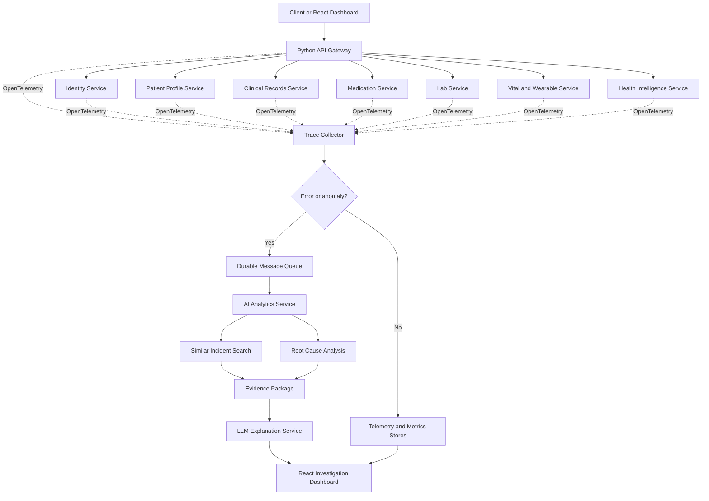

# BioSync Failure Intelligence Platform

A Python-first observability and AI incident-analysis platform built from the healthcare capabilities of BioSync AI.

The platform answers a practical operational question:

> **Why did this request, workflow, or health-data processing job fail?**

It does this by correlating API gateway telemetry, service traces, logs, metrics, database events, queue messages, and deployment metadata. When an error or anomaly is detected, an asynchronous analytics pipeline finds similar incidents, identifies the most likely root cause, and uses an LLM to produce a clear, evidence-backed explanation in a React dashboard.

This repository is the architecture and implementation foundation for the new platform. The original BioSync AI application is the source of domain behavior, data models, and API contracts; it is not assumed to be microservice-ready today.

## Documentation

- [Target architecture](docs/11_Failure_Intelligence_Architecture.md)
- [Original BioSync AI product vision](docs/01_Product_Vision.md)
- [Original high-level design](docs/03_HLD.md)
- [Original AI architecture](docs/08_AI_Architecture.md)
- [Original deployment guide](docs/09_Deployment.md)

## Why This Project Exists

BioSync AI currently follows a modular-monolith shape: one FastAPI application exposes authentication, patient records, clinical data, wearable data, timeline, dashboard, and health-intelligence behavior. That is a good starting point for domain development, but it does not provide a complete answer when a workflow fails across multiple modules or asynchronous boundaries.

The new platform adds:

- consistent request correlation with W3C trace context;
- OpenTelemetry traces, metrics, and structured logs;
- an API gateway that exposes one client entry point;
- independently deployable domain services;
- durable error and anomaly events through a message queue;
- deterministic analytics before generative AI;
- similar-incident retrieval and evidence-based root-cause analysis;
- an LLM explanation layer with citations to telemetry evidence;
- a React operations dashboard for incident investigation;
- automated unit, contract, integration, resilience, security, and end-to-end testing.

## Proposed Service Landscape

| Service | Responsibility | Source capability in BioSync AI |
| --- | --- | --- |
| API Gateway | Authentication enforcement, routing, rate limits, request IDs, trace entry point | FastAPI application entry point and API router |
| Identity Service | Users, JWT lifecycle, roles, authorization context | `auth`, `users` |
| Patient Profile Service | Patient profile and ownership boundaries | `patient_profiles` |
| Clinical Records Service | Diagnoses, allergies, hospital records, vaccinations, manual entries | Corresponding clinical APIs and models |
| Medication Service | Medications, prescriptions, prescription items | Medication and prescription modules |
| Lab Service | Lab reports and lab results | Lab report modules |
| Vital and Wearable Service | Vital signs, wearable ingestion, normalization | Vital and wearable modules |
| Health Intelligence Service | Trends, timeline, dashboard projections, deterministic insights | `timeline_service`, `dashboard_service`, `health_intelligence_service`, `insight_service` |
| Trace Collector | Telemetry ingestion and normalization | New platform capability |
| Incident Analytics Service | Anomaly classification, fingerprinting, similarity, root-cause hypotheses | New platform capability |
| LLM Explanation Service | Controlled explanation generation from approved evidence | New platform capability; conceptually extends BioSync AI AI architecture |
| Dashboard | Incident search, trace waterfall, evidence, root-cause explanation, feedback | New React application |

The first implementation can run these services as separate Python processes or containers while sharing a carefully versioned platform library. A service boundary is useful only when ownership, data access, deployment, and observability boundaries are explicit.

## End-to-End Flow



## Technology Direction

- **Language:** Python 3.12+
- **HTTP services:** FastAPI and Uvicorn
- **Validation:** Pydantic v2
- **Persistence:** PostgreSQL; TimescaleDB extension for time-series telemetry where appropriate
- **ORM and migrations:** SQLAlchemy and Alembic
- **Messaging:** Redis Streams for local development, with a Kafka or managed queue option for production scale
- **Observability:** OpenTelemetry SDK, Collector, Prometheus-compatible metrics, and an OpenSearch/Loki-compatible log store
- **AI:** deterministic rules and statistical detectors first; vector similarity second; local Ollama or a hosted LLM behind a provider interface
- **Frontend:** React and TypeScript
- **Packaging:** Docker Compose locally; Kubernetes or a managed container platform for production
- **Testing:** pytest, httpx, Testcontainers, contract tests, Playwright, and fault-injection tests

## Local Development

The current BioSync backend can be run independently while the new services are introduced incrementally.

```bash
cd backend
python -m venv .venv
source .venv/bin/activate
pip install -r requirements.txt
uvicorn app.main:app --reload
```

The original backend expects database and security settings in `backend/.env`; never commit secrets. The new platform should use environment-specific configuration and secret management from its first service extraction.

## Delivery Phases

1. **Baseline:** instrument the existing BioSync modular monolith and establish trace, log, and metric conventions.
2. **Gateway:** add a single gateway and propagate trace context into the existing backend.
3. **Extraction:** extract identity, patient profiles, clinical records, medications, labs, vitals/wearables, and intelligence one boundary at a time.
4. **Incident pipeline:** publish normalized error/anomaly events, implement fingerprints, and persist evidence packages.
5. **AI analysis:** add similar-incident retrieval, deterministic root-cause ranking, and a guarded LLM explanation layer.
6. **Dashboard and validation:** build investigation workflows, run failure scenarios, and compare behavior with the original BioSync APIs.

The architecture document contains the detailed contracts, data ownership rules, security model, testing matrix, operational concerns, and acceptance criteria.

## Important Safety Boundary

This system explains software and data-pipeline failures. It must not make clinical diagnoses or present operational root-cause output as medical advice. Patient data should be minimized in telemetry, redacted before leaving a service boundary, encrypted in transit and at rest, and access-controlled with auditable operator actions.
