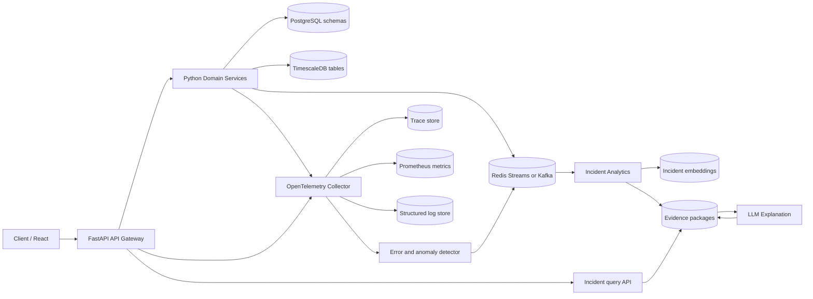

# BioSync Failure Intelligence Platform
## Detailed Python Microservices Architecture

| Document Version | 1.0 |
| --- | --- |
| Parent system | BioSync AI |
| Architecture style | Event-assisted microservices with centralized observability |
| Primary language | Python |
| Status | Proposed target architecture |

## 1. Executive Summary

BioSync AI is the domain foundation for a personal health operating system. Its current backend is a FastAPI modular monolith with SQLAlchemy, Alembic, PostgreSQL-oriented configuration, JWT authentication, clinical record APIs, wearable data, timeline, dashboard, and health-intelligence services.

This project turns those capabilities into a testable distributed system and adds an operational intelligence plane. A client enters through an API Gateway. The gateway routes requests to domain services. Every hop propagates a trace ID. The Trace Collector receives traces, metrics, and structured logs. A detector identifies failures and unusual behavior, then publishes an incident event to a durable queue. AI Analytics builds a bounded evidence package, searches for similar incidents, ranks root-cause hypotheses, and asks an LLM to explain the result. The React dashboard lets an operator inspect the original request, trace waterfall, logs, dependency calls, evidence, and explanation.

The LLM is an explanation assistant, not the source of truth. Root-cause claims must be supported by telemetry evidence and must expose uncertainty.

## 2. Goals and Non-Goals

### Goals

- Preserve BioSync domain behavior while creating deployable ownership boundaries.
- Explain failures across synchronous HTTP and asynchronous message flows.
- Detect both explicit errors and latency, availability, and data-quality anomalies.
- Make every explanation reproducible from a stored evidence package.
- Keep sensitive health information out of logs and model prompts by default.
- Provide a testing strategy that can prove behavior, contracts, resilience, and trace coverage.

### Non-goals

- Replacing clinical decision-making or diagnosing patients.
- Allowing an LLM to execute production remediation automatically.
- Splitting every existing Python module into a network service immediately.
- Treating a trace visualization as a substitute for metrics, logs, or domain tests.

## 3. Architectural Planes

### 3.1 Request plane

The request plane handles user-facing traffic:

`Client -> API Gateway -> Domain Service -> Database or downstream service`

The gateway owns external concerns such as authentication enforcement, routing, rate limits, CORS, request size limits, and trace creation. Domain services own business rules and their data. Services communicate over versioned HTTP APIs for request/response operations.

### 3.2 Event plane

The event plane handles work that should not delay the client:

`Service -> Queue -> Consumer`

Examples include wearable ingestion, notification work, audit events, anomaly events, and incident analysis. Events are immutable facts with an event ID, schema version, occurred-at timestamp, producer, trace ID, and idempotency key.

### 3.3 Observability plane

Each service emits:

- traces for request and dependency spans;
- metrics for volume, errors, latency, saturation, queue lag, and domain outcomes;
- JSON logs correlated by `trace_id`, `span_id`, `request_id`, and `incident_id`.

The OpenTelemetry Collector receives telemetry through OTLP and exports it to the selected trace, metric, and log stores. Application services do not call the analytics service directly for every error; this prevents failure amplification.

### 3.4 Intelligence plane

The intelligence plane consumes normalized incidents, not arbitrary raw logs:

`Incident Event -> Normalizer -> Fingerprint -> Similarity Search -> Root-Cause Ranker -> Evidence Package -> LLM Explanation`

The intelligence plane is asynchronous and independently scalable. Dashboard reads use stored incident analyses so an operator can revisit an explanation after the original service has recovered.

## 4. Service Boundaries

### API Gateway

**Owns:** public routing, auth verification, request correlation, quotas, edge validation, and aggregation of dashboard-safe responses.

**Does not own:** clinical business rules or direct database access to domain tables.

**Interfaces:** external REST API, internal HTTP forwarding, health/readiness endpoints.

### Identity Service

**Owns:** users, password hashes, JWT issuance/rotation, roles, and authorization claims. It is extracted from the existing `auth` and `users` modules.

**Data:** identity database schema. Other services receive a subject and claims, not password data.

### Patient Profile Service

**Owns:** patient profile, patient ownership, consent and profile-level access checks. It is extracted from `patient_profiles`.

**Data:** profile database schema. Clinical services refer to `patient_id` rather than joining profile tables.

### Clinical Records Service

**Owns:** diagnoses, allergies, hospital records, vaccinations, and manual entries. These modules share clinical-record lifecycle concerns and can initially be one deployable service.

### Medication Service

**Owns:** medications, prescriptions, and prescription items. It validates medication relationships and publishes medication-change events.

### Lab Service

**Owns:** lab reports and lab results, including ingestion status and normalization errors.

### Vital and Wearable Service

**Owns:** vital signs, wearable ingestion, source normalization, timestamps, deduplication, and time-series writes. It publishes accepted, rejected, and corrected-measurement events.

### Health Intelligence Service

**Owns:** timeline projections, dashboard projections, trends, recovery scoring, deterministic recommendations, and insight text. It is the extraction target for the current `timeline_service`, `dashboard_service`, `health_intelligence_service`, `baseline_service`, and `insight_service`.

It must preserve BioSync's existing rule that deterministic health calculations precede LLM communication. Operational incident analysis is separate from patient health recommendations.

### Trace Collector

**Owns:** telemetry intake, batching, enrichment, sampling, export, and temporary buffering. It does not contain domain logic.

### Incident Analytics Service

**Owns:** incident normalization, anomaly detection, grouping, similarity retrieval, root-cause ranking, evidence package creation, and analysis status transitions.

### LLM Explanation Service

**Owns:** prompt assembly, model-provider abstraction, output schema validation, redaction enforcement, token budgets, timeout/retry policy, and explanation persistence.

The service receives only an evidence package. It cannot query production databases or invoke arbitrary tools.

### React Dashboard

**Owns:** incident list, filters, trace waterfall, timeline, logs, dependency graph, similar incidents, root-cause hypotheses, explanation, confidence, and operator feedback. It never embeds model credentials or accesses telemetry stores directly.

## 5. Deployment Topology



### Local profile

Docker Compose should run the gateway, selected domain services, PostgreSQL, Redis, OpenTelemetry Collector, a local telemetry backend, the analytics worker, Ollama, and the React development server. The original backend can remain available as a compatibility profile during extraction.

### Production profile

Run stateless Python services as containers behind an ingress or managed gateway. Use managed PostgreSQL, a durable managed queue, centralized telemetry storage, a private model endpoint or approved hosted provider, and a secret manager. Scale API services on CPU/request latency; scale consumers on queue depth and processing age.

## 6. Communication Contracts

### Trace context

All HTTP requests and queue messages carry W3C Trace Context. Required metadata:

```json
{
  "trace_id": "4bf92f3577b34da6a3ce929d0e0e4736",
  "span_id": "00f067aa0ba902b7",
  "request_id": "req_01J...",
  "incident_id": "inc_01J...",
  "service_name": "vital-wearable-service",
  "environment": "staging"
}
```

A service must accept an incoming trace context, create a child span, and return the request ID and trace ID in response headers. Queue consumers create a consumer span linked to the producer span.

### Incident event

```json
{
  "event_id": "evt_01J...",
  "event_type": "incident.detected",
  "schema_version": 1,
  "occurred_at": "2026-08-28T12:30:00Z",
  "incident_id": "inc_01J...",
  "trace_id": "4bf92f3577b34da6a3ce929d0e0e4736",
  "service": "lab-service",
  "environment": "production",
  "severity": "high",
  "fingerprint": "lab-service|POST|/lab-reports|database-timeout",
  "signal": "exception",
  "summary": "Database operation timed out",
  "evidence_refs": ["span:abc", "log:def", "metric:ghi"]
}
```

Consumers must be idempotent by `event_id` and support retries with exponential backoff and a dead-letter stream.

### Analysis response

The dashboard API returns an analysis with `status`, `confidence`, `hypotheses`, `evidence`, `similar_incidents`, `explanation`, `limitations`, `created_at`, and `model_metadata`. The explanation is invalid unless each material claim maps to one or more evidence references.

## 7. Incident Detection and Root-Cause Analysis

### Detection signals

- HTTP 5xx and unhandled exceptions;
- repeated 4xx spikes indicating contract or authorization regressions;
- latency above route-specific SLO thresholds;
- database pool exhaustion, timeout, or connection errors;
- queue lag, retry growth, and dead-letter messages;
- unusual wearable or lab data rejection rates;
- dependency availability and circuit-breaker state;
- deployment-correlated error-rate changes.

### Analysis stages

1. **Normalize:** map heterogeneous telemetry to a stable incident schema.
2. **Group:** combine related events by trace, time window, service, route, deployment, and fingerprint.
3. **Collect evidence:** retrieve bounded spans, logs, metrics, dependency health, recent deployments, and relevant queue history.
4. **Rank hypotheses:** use deterministic rules first, for example a downstream timeout preceding an upstream 502.
5. **Find similar incidents:** search fingerprints and embeddings over redacted historical incident summaries.
6. **Generate explanation:** pass the evidence package to the LLM using a strict structured-output contract.
7. **Persist and publish:** store the analysis and notify the dashboard; preserve the original evidence references.

### Root-cause ranking example

A hypothesis gains confidence when the same trace shows:

- a downstream database span timing out;
- the owning service returning a 503;
- the gateway returning a 502 shortly afterward;
- an elevated database pool wait metric;
- no corresponding application deployment.

The result should say that the database timeout is the leading hypothesis, identify the gateway 502 as a symptom, and state what evidence is missing. It should not claim certainty merely because an LLM produced fluent text.

## 8. Data and Privacy Architecture

Each service owns its write model and exposes APIs or events for other services. Shared database tables and cross-service foreign-key joins are prohibited after extraction. A reporting or incident store may contain denormalized, redacted copies.

Telemetry rules:

- never log access tokens, passwords, raw request bodies, authorization headers, or full medical documents;
- use patient and user pseudonyms or opaque IDs where correlation is needed;
- redact health values unless they are essential to diagnosing a data-pipeline failure;
- apply retention by data class, with shorter retention for raw logs and longer retention for aggregate incident records;
- encrypt transport and storage;
- audit incident access, export, feedback, and explanation regeneration;
- apply role-based access and patient-data consent rules independently from operator incident roles.

The prompt gateway performs a second redaction pass and rejects prompts containing secrets or prohibited health data. Model inputs and outputs are versioned for auditability.

## 9. Security and Reliability

- Validate JWTs at the gateway and revalidate service authorization for sensitive operations.
- Use mTLS or workload identity for service-to-service calls in production.
- Store secrets in environment injection from a secret manager, never in source or telemetry.
- Apply timeouts, bounded retries, circuit breakers, and idempotency keys to every remote call.
- Use bulkheads so a slow LLM or telemetry backend cannot block patient-data APIs.
- Make incident analysis eventually consistent; a failed analytics worker must not fail the original user request.
- Provide `/health/live` and `/health/ready` endpoints and expose dependency health separately.
- Define SLOs for gateway availability, route latency, event processing age, and analysis completion time.

## 10. Testing Strategy

### Unit tests

Test domain rules, Pydantic schemas, authorization decisions, fingerprint generation, anomaly thresholds, evidence ranking, redaction, and LLM output validation without network calls.

### API and contract tests

Use FastAPI test clients and schema snapshots for each service. Verify gateway routing, error envelopes, headers, pagination, authentication, and backward-compatible BioSync endpoints. Consumer-driven contracts must verify event schema versions and required metadata.

### Integration tests

Run PostgreSQL, Redis, telemetry collector, and selected services in disposable containers. Verify migrations, transaction boundaries, outbox publishing, idempotent consumers, retries, dead-letter handling, and trace propagation through HTTP and queue boundaries.

### Observability tests

For each critical workflow, assert that:

- one trace contains gateway and downstream spans;
- every service span has service, route, status, and duration attributes;
- logs include trace and request correlation IDs;
- failures publish exactly one deduplicated incident event;
- sensitive fields are absent from logs, events, evidence, and prompts.

### Resilience and fault-injection tests

Inject database timeouts, unavailable dependencies, malformed wearable data, queue delay, duplicate events, telemetry exporter failure, and LLM timeout. Verify graceful degradation, correct classification, no request cascade, and eventual recovery.

### End-to-end tests

Playwright should cover login, a representative BioSync health-data workflow, induced service failure, incident appearance, trace inspection, similar-incident display, root-cause explanation, feedback, and access control. Test both desktop and mobile dashboard layouts.

### AI evaluation

Maintain a redacted golden incident set with expected evidence references, acceptable hypotheses, refusal cases, and confidence ranges. Score groundedness, evidence coverage, consistency, redaction, latency, and cost. A model response that contradicts telemetry fails evaluation even if it sounds plausible.

## 11. Migration Strategy from BioSync AI

1. Add shared telemetry middleware and structured logging to the existing FastAPI application.
2. Establish API and behavior baselines for the current routers and health-intelligence calculations.
3. Introduce the gateway in front of the modular monolith with trace propagation.
4. Extract the lowest-coupling service first, preferably identity or wearable ingestion, behind a compatibility API.
5. Move one data owner at a time; replace direct imports with HTTP clients or versioned events.
6. Keep the original endpoint responses stable until contract tests pass against the extracted service.
7. Route a small staging traffic percentage to the new service and compare latency, errors, and domain results.
8. Enable incident event publication, analytics, and dashboard only after telemetry coverage is complete.
9. Retire old module paths after migration evidence and rollback windows are satisfied.

## 12. Acceptance Criteria

The target platform is ready for its first production pilot when:

- a single request can be followed from gateway through at least three domain services;
- an injected downstream failure creates one incident with a complete trace;
- the dashboard displays the trace, correlated logs, dependency timing, and incident status;
- similar incidents are retrieved only from redacted historical records;
- the leading root-cause hypothesis cites concrete telemetry evidence;
- the LLM cannot access production tools or unredacted patient data;
- duplicate and out-of-order events do not corrupt incident state;
- service and contract tests pass in CI;
- a failed analytics or LLM dependency does not break the originating health-data request;
- rollback and data-retention procedures have been exercised in staging.

## 13. Recommended Repository Shape

```text
biosync-failure-intelligence/
  services/
    api-gateway/
    identity/
    patient-profile/
    clinical-records/
    medication/
    lab/
    vital-wearable/
    health-intelligence/
    incident-analytics/
    llm-explanation/
  packages/
    contracts/
    observability/
    security/
    testing/
  dashboard/
  infra/
    compose/
    otel/
    migrations/
  tests/
    contract/
    integration/
    resilience/
    e2e/
  docs/
```

The shared packages should contain only stable cross-cutting concerns. Domain models, repositories, and business rules remain inside their owning service so extraction does not recreate a distributed monolith through a shared Python package.
